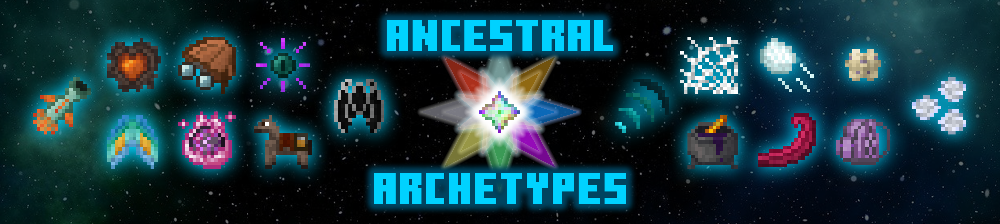

<div align="center">



# Pick one of 30+ Mobs and gain unique abilities!

**Server-Side Origins-inspired mod for Fabric.**

[](https://modrinth.com/mod/ancestral-archetypes)
[](https://www.curseforge.com/minecraft/mc-mods/ancestral-archetypes)
[](https://modrinth.com/mod/ancestral-archetypes/versions)
[](https://github.com/borisshoes/AncestralArchetypes/releases/latest)

[](https://discord.gg/dTKPeNEg6r)
[](https://modrinth.com/mod/fabric-api)
[](#installation)

</div>

Ancestral Archetypes is an Origins-style Fabric mod that only needs to be installed on the server. Each player picks an Archetype based on a Minecraft mob and plays with that mob's abilities and drawbacks. The mod is highly configurable and balanced around a competitive environment.

## Contents
- [Features](#features)
- [Getting Started](#getting-started)
- [Archetypes](#archetypes)
- [Videos](#videos)
- [Installation](#installation)
- [Customizing Archetypes](#customizing-archetypes)
- [Commands](#commands)
- [Admin Configuration Commands](#admin-configuration-commands)
- [Permission Nodes](#permission-nodes)
- [Building from Source](#building-from-source)
- [Support and Contributing](#support-and-contributing)
- [Try My Other Mods!](#try-my-other-mods)
- [License](#license)

The Admin Configuration Commands section is long. Use the outline button at the top right of this file on GitHub, or your browser's search, to jump to a specific setting.

## Features
- **30 playable mobs in 11 Archetypes**, from Axolotl and Fox to Warden and Ender Dragon, each with its own strengths and drawbacks.
- **Around 100 abilities.** Fire volleys of fireballs, teleport like an Enderman, glide on wings, ride a soulbound Spirit Mount, burrow through the ground or brew free potions.
- **Meaningful weaknesses.** Aquarians dry out on land, Infernals freeze in the cold, Golems cannot regenerate naturally. Every pick is a trade-off.
- **Balanced for multiplayer.** Designed around a competitive environment, with team-aware abilities and a spyglass mechanic for scouting what other players are.
- **In-game GUIs.** Players browse and pick Archetypes from a menu, and can read every ability with its exact numbers.
- **Built for servers.** No client mods, a resource pack served by the server, 200+ config options that can be changed without a restart, and a permission node for every command.
- **Make it your own.** Admins can add or remove abilities on any Archetype with a command, including [variant abilities](#customizing-archetypes) that no Archetype uses by default.
- **Full translation support** through language files.

## Getting Started
1. **Pick an Archetype.** Run `/archetypes changeArchetype` to open the selection menu and choose your mob. New players can do this once by default, so read before you pick!
2. **Learn your abilities.** `/archetypes abilities` lists what your mob can do, with the exact values your server uses.
3. **Get your Ability Items.** Active abilities are used through items. `/archetypes items` gives them to you, and gives them back if you lose them.
4. **Scout other players.** Look at a player through a spyglass for a few seconds to reveal their Archetype.

Not sure what to pick? `/archetypes list` lets you browse every Archetype and its abilities without choosing one.

**Changing Archetypes.** Each change uses up one of your allowed changes. Server admins can give more with `/archetypes addChanges`, hand out the **Archetype Changer** item (`ancestralarchetypes:change_item`), or turn on `canAlwaysChangeArchetype` to remove the limit. `archetypeChangeCooldown` adds a waiting period between changes.

The Archetype Changer has no recipe on purpose. Server owners decide how players get it, for example by adding a crafting recipe, loot table entry or trade for `ancestralarchetypes:change_item` with a datapack.

**Customizing your look.** Centaurs can rename their mount with `/archetypes setMountName` and Horses can pick a coat with `/archetypes setHorseVariant`. Parrots and Ender Dragons can recolor their wings with `/archetypes setGliderColor`, and Ghastlings their helmet with `/archetypes setHelmetColor`.

## Archetypes
There are 30 mobs to play as, grouped into 11 Archetypes. Mobs in the same Archetype share a theme and usually a weakness.

| Archetype | Mobs | Theme |
|---|---|---|
| **Aquarians** | Axolotl, Guardian, Salmon | Masters of water that struggle on dry land. |
| **Canids** | Fox, Wolf | Two sides of the social coin: Wolves grow stronger in a pack, Foxes do better alone. |
| **Centaurs** | Horse, Donkey, Camel | Riders bonded to a soulbound Spirit Mount. |
| **Enderians** | Enderman, Shulker, Ender Dragon | Teleporting beings of the End that fear water. |
| **Felids** | Cat, Ocelot | Quick, quiet and always landing on their feet. |
| **Gelatians** | Slime, Magma Cube, Sulfur Cube | Bouncy cubes that shrink instead of dying. |
| **Golems** | Copper Golem, Tuff Golem, Iron Golem | Constructs that eat metal and stone instead of food. |
| **Infernals** | Blaze, Wither Skeleton, Strider | Fireproof natives of the Nether that hate the cold. |
| **Sentinels** | Creaking, Warden | Guardians of the dark with powerful, risky abilities. |
| **Swampers** | Witch, Cave Spider, Frog | Swamp dwellers empowered by the moon. |
| **Windswepts** | Breeze, Parrot, Ghastling | Light, airborne creatures that never fall hard. |

Expand an Archetype below for the full list of what each mob gets. ➕ is a benefit, ➖ is a drawback and 🔹 is neutral. The exact numbers behind every ability are shown in game by `/archetypes abilities <archetype>`, and are all [configurable](#admin-configuration-commands).

<details>
<summary><b>Aquarians</b>: Axolotl, Guardian, Salmon. Masters of water that struggle on dry land.</summary>

<a href="non-mod-resources/Aquarian%20Infographic.png"></a>

**Axolotl**
- ➕ Regenerates below half health
- ➕ Gains slight resistance in water and rain
- ➕ Has Conduit Power, Aqua Affinity and Depth Strider
- ➖ Takes bonus damage from Impaling
- ➖ Takes damage in dry biomes without Fire Resistance or a Turtle Shell

**Guardian**
- ➕ Has a powerful piercing Ray attack
- ➕ Reflects a portion of damage taken
- ➕ Gains slight resistance in water and rain
- ➕ Has Conduit Power, Aqua Affinity and Depth Strider
- ➖ Takes bonus damage from Impaling
- ➖ Takes damage in dry biomes without Fire Resistance or a Turtle Shell

**Salmon**
- ➕ Gains heavy resistance in water and rain
- ➕ Has enhanced Conduit Power, Aqua Affinity and Depth Strider
- ➖ Takes bonus damage from Impaling
- ➖ Takes damage in dry biomes without Fire Resistance or a Turtle Shell

</details>

<details>
<summary><b>Canids</b>: Fox, Wolf. Two sides of the social coin: Wolves grow stronger in a pack, Foxes do better alone.</summary>

<a href="non-mod-resources/Canid%20Infographic.png"></a>

**Fox**
- ➕ Permanent speed increase
- ➕ Eating sweet berries grants regeneration and strength
- ➕ Eating glow berries grants speed and absorption
- 🔹 Nearby enemy players increase speed but reduce damage dealt
- 🔹 1.5 blocks tall
- ➖ 25% less max health
- ➖ Can only eat meat or berries

**Wolf**
- ➕ Nearby allies grant stacking strength and speed
- ➕ Scares skeletons
- ➖ Can only eat meat

</details>

<details>
<summary><b>Centaurs</b>: Horse, Donkey, Camel. Riders bonded to a soulbound Spirit Mount.</summary>

<a href="non-mod-resources/Centaur%20Infographic.png"></a>

**Horse**
- ➕ Gains a soulbound, heavily armored, agile horse mount
- ➕ When Mounted: extra reach, every hit crits, can mine normally
- ➖ Briefly stunned by damage

**Donkey**
- ➕ Gains a soulbound donkey mount with 54 slots of soulbound storage
- ➕ When Mounted: extra reach, every hit crits, can mine normally
- ➖ Briefly stunned by damage

**Camel**
- ➕ Gains a soulbound camel mount with an extra seat and powerful lunge
- ➕ When Mounted: extra reach, every hit crits, can mine normally
- ➖ Briefly stunned by damage

</details>

<details>
<summary><b>Enderians</b>: Enderman, Shulker, Ender Dragon. Teleporting beings of the End that fear water.</summary>

<a href="non-mod-resources/Enderian%20Infographic.png"></a>

**Enderman**
- ➕ Can teleport to a targeted location or through walls
- ➕ Hand-mined blocks are Silk Touched
- ➕ Resistant to projectiles
- ➕ Extra reach
- 🔹 2.5 blocks tall
- ➖ Frozen by direct eye contact
- ➖ Damaged by water and rain without Water Breathing

**Shulker**
- ➕ Can fire a volley of tracking levitation bullets
- ➕ Can teleport to a random nearby spot
- ➕ Gains a small soulbound backpack
- ➕ Can immobilize self for heavy resistance
- ➖ Damaged by water and rain without Water Breathing

**Ender Dragon**
- ➕ Wings allow brief gliding
- ➕ Can breathe Enderflame in an area or shoot a fireball
- ➕ Can be ridden by other players
- ➕ Extra reach
- 🔹 3.5 blocks tall
- 🔹 Reduced knockback taken
- ➖ Damaged by water and rain without Water Breathing

</details>

<details>
<summary><b>Felids</b>: Cat, Ocelot. Quick, quiet and always landing on their feet.</summary>

<a href="non-mod-resources/Felid%20Infographic.png"></a>

**Cat**
- ➕ Immune to fall damage
- ➕ Faster while sneaking
- ➕ Permanent speed increase
- ➕ Scares creepers and phantoms
- ➖ Can only eat meat

**Ocelot**
- ➕ First hit on a mob deals bonus damage
- ➕ Attacking a player from behind deals bonus damage
- ➕ Permanent speed increase
- ➕ Reduced fall damage taken
- ➖ Can only eat meat

</details>

<details>
<summary><b>Gelatians</b>: Slime, Magma Cube, Sulfur Cube. Bouncy cubes that shrink instead of dying.</summary>

<a href="non-mod-resources/Gelatian%20Infographic.png"></a>

**Slime**
- ➕ Fatal damage reduces size and max health instead of killing, twice per life
- ➕ Can eat slime balls to regrow
- ➕ Increased jump strength
- ➕ Bounces on terrain
- ➖ Drastically increased hunger rate

**Magma Cube**
- ➕ Immune to fire
- ➕ Melee attacks ignite enemies
- ➕ Fatal damage reduces size and max health instead of killing, twice per life
- ➕ Can eat magma cream to regrow
- ➕ Increased jump strength
- ➕ Bounces on terrain
- ➖ Damaged by snowballs and cold biomes without Water Breathing
- ➖ Drastically increased hunger rate

**Sulfur Cube**
- ➕ Can absorb blocks to gain their properties
- ➕ Fatal damage reduces size and max health instead of killing, once per life
- ➕ Can eat sulfur spikes to regrow
- ➕ Increased jump strength
- ➕ Bounces on terrain
- ➖ Reduced melee damage
- ➖ Drastically increased hunger rate
- ➖ Cannot absorb blocks when small
- ➖ Cannot activate sulfur totem when metamorphed

</details>

<details>
<summary><b>Golems</b>: Copper Golem, Tuff Golem, Iron Golem. Constructs that eat metal and stone instead of food.</summary>

<a href="non-mod-resources/Golem%20Infographic.png"></a>

**Copper Golem**
- ➕ Can apply Honeycomb for absorption
- ➕ Resistant to projectiles
- ➕ Can fall safely from higher
- ➕ Can walk over crops, magma blocks and sculk safely
- 🔹 1 block tall
- 🔹 Eats Copper items to heal directly
- 🔹 Sprint is based on health percentage
- 🔹 Takes increased knockback
- ➖ Halved max health
- ➖ Reduced melee damage
- ➖ No natural regeneration

**Tuff Golem**
- ➕ Permanent haste and attack speed
- ➕ Resistant to projectiles
- 🔹 Eats Tuff items to heal directly
- 🔹 Sprint is based on health percentage
- ➖ No natural regeneration

**Iron Golem**
- ➕ Deals extra melee damage and knockback
- ➕ Doubled max health
- ➕ Resistant to projectiles
- ➕ Extra reach
- 🔹 Eats Iron items to heal directly
- 🔹 Sprint is based on health percentage
- 🔹 Takes reduced knockback
- 🔹 3 blocks tall
- ➖ No natural regeneration

</details>

<details>
<summary><b>Infernals</b>: Blaze, Wither Skeleton, Strider. Fireproof natives of the Nether that hate the cold.</summary>

<a href="non-mod-resources/Infernal%20Infographic.png"></a>

**Blaze**
- ➕ Can fire a volley of fireballs
- ➕ Immune to fire
- ➕ Melee attacks ignite enemies
- ➕ Gains slow falling when falling quickly
- ➖ Damaged by snowballs and cold biomes without Water Breathing

**Wither Skeleton**
- ➕ Melee attacks wither enemies
- ➕ Immune to withering
- ➕ Immune to fire
- 🔹 2.5 blocks tall
- ➖ Damaged by snowballs and cold biomes without Water Breathing

**Strider**
- ➕ Can be ridden by other players
- ➕ Can eat Warped Fungus for a speed boost
- ➕ Can stride through lava
- ➕ Immune to fire
- 🔹 2.5 blocks tall
- ➖ Damaged by snowballs and cold biomes without Water Breathing

</details>

<details>
<summary><b>Sentinels</b>: Creaking, Warden. Guardians of the dark with powerful, risky abilities.</summary>

<a href="non-mod-resources/Sentinel%20Infographic.png"></a>

**Creaking**
- ➕ Can place a destructible Creaking Heart: grants heavy resistance and strength
- ➕ Can respawn at the Creaking Heart
- ➖ Cannot leave the area of the Creaking Heart without removing it
- ➖ Creaking Heart gives brief slowness and weakness upon destruction
- ➖ Sunlight applies slight weakness
- ➖ Frozen by direct eye contact

**Warden**
- ➕ Can unleash a massive Sonic Boom
- ➕ Can burrow through the ground
- ➕ Melee attacks deal increased damage and knockback
- ➕ Nearby sounds become visual cues
- ➕ Doubled max health
- 🔹 3 blocks tall
- 🔹 Takes reduced knockback
- ➖ Nearsighted

</details>

<details>
<summary><b>Swampers</b>: Witch, Cave Spider, Frog. Swamp dwellers empowered by the moon.</summary>

<a href="non-mod-resources/Swamper%20Infographic.png"></a>

**Witch**
- ➕ Can periodically brew a free potion
- ➕ Better potions during fuller moons
- ➕ Immune to poison

**Cave Spider**
- ➕ Melee attacks poison enemies
- ➕ Fuller moons apply stronger poison and grant a potion buff
- ➕ Can throw a web periodically
- ➕ Can climb like a spider
- ➕ Can fall safely from higher
- ➕ Can walk over crops, magma blocks and sculk safely
- ➕ Less affected by cobwebs
- 🔹 1 block tall
- 🔹 Takes increased knockback
- ➖ Halved max health
- ➖ Deals reduced melee damage

**Frog**
- ➕ Sticky tongue attack applies a biome-specific debuff
- ➕ Sneaking charges a big leap
- ➕ Can fall safely from higher
- ➕ Can walk over crops, magma blocks and sculk safely
- ➕ Fuller moons increase max health
- ➕ Immune to poison
- 🔹 1 block tall
- 🔹 Takes increased knockback
- ➖ Halved max health
- ➖ Deals reduced melee damage

</details>

<details>
<summary><b>Windswepts</b>: Breeze, Parrot, Ghastling. Light, airborne creatures that never fall hard.</summary>

<a href="non-mod-resources/Windswept%20Infographic.png"></a>

**Breeze**
- ➕ Can unleash a blast of Wind Charges
- ➕ Resistant to projectiles
- ➕ Sneaking charges a big leap
- ➕ Gains slow falling when falling quickly
- ➖ Deals reduced melee damage

**Parrot**
- ➕ Wings allow brief gliding and grant a speed boost
- ➕ Can walk over crops, magma blocks and sculk safely
- ➕ Gains slow falling when falling quickly
- 🔹 Takes increased knockback
- ➖ Allergic to chocolate

**Ghastling**
- ➕ Can hover slowly for a prolonged period
- ➕ Can launch a freezing blast
- ➕ Gains slow falling when falling quickly
- ➕ Can be ridden by other players
- ➖ Takes damage in dry biomes without Fire Resistance or a Turtle Shell

</details>

All of the infographics are also available as [one image](non-mod-resources/Full%20Infographic.png).

## Videos
| Mod Spotlight / Tutorial | 1.2.0 Changes Showcase | 1.3.0 Changes Showcase |
|:---:|:---:|:---:|
| [](https://www.youtube.com/watch?v=QApJcu1rpD0) | [](https://www.youtube.com/watch?v=ZWrzjhnXP8E) | [](https://www.youtube.com/watch?v=8HL_ekXbSds) |

## Installation
1. Install [Fabric Loader](https://fabricmc.net/use/server/) and [Fabric API](https://modrinth.com/mod/fabric-api) on your server.
2. Download Ancestral Archetypes from [Modrinth](https://modrinth.com/mod/ancestral-archetypes), [CurseForge](https://www.curseforge.com/minecraft/mc-mods/ancestral-archetypes) or [GitHub Releases](https://github.com/borisshoes/AncestralArchetypes/releases) and put the jar in the server's `mods` folder. Every other library the mod uses is bundled in the jar.
3. Set up the resource pack as described below.

Players do not need to install anything.

### Resource Pack
The server has the ability to automatically generate and serve the mod's resource pack to your players when they connect. To do this, you must enable auto-host:
1. Launch the server with the mod installed at least once to generate the configs.
2. Open `config/polymer/auto-host.json` in the server folder.
3. In the first few lines there will be a line that says `"enabled": false`. Change this to `true`.
4. (Optional) You can also set the value to make the resource pack required by players, or set the `"message"` line to inform players why the resource pack is important to download when they are prompted to have it be auto downloaded.

If everything is done correctly, then players will automatically load into the server with the resource pack installed. Without the resource pack the mod still works, but Ability Items show as vanilla items instead of their own textures.

## Customizing Archetypes
Every Archetype's ability list can be edited in game, without a restart:
* `/archetypes addArchetypeAbility <subarchetype> <ability>` adds an ability to a mob.
* `/archetypes removeArchetypeAbility <subarchetype> <ability>` removes one.
* `/archetypes resetArchetypeAbilities <subarchetype>` restores the defaults.

### Variant Abilities
There are a few variants of abilities that are not used by any Archetype by default, but can be added with the commands above. These are:
* `Short-Legged` Reduces player step height by 0.5 blocks.
* `Long-Legged` Increases player step height by 1 block.
* `Vulnerable in Water` You take 50% extra damage when in water and rain.
* `Vulnerable when Dry` You take 50% extra damage when in hot biomes without a Turtle Shell or Fire Resistance.
* `Vulnerable when Cold` You take 50% extra damage when in cold biomes without Water Breathing.

## Commands
### Player Commands
* `/archetypes changeArchetype` Opens a GUI for a user to change their Archetype.
* `/archetypes list` Opens a GUI for a user to view all Archetypes.
* `/archetypes abilities` Shows the abilities and descriptions for your Archetype, as well as any relevant config values.
* `/archetypes abilities <archetype>` Shows the above command for the specified Archetype.
* `/archetypes items` Gives a user the Ability Items for their Archetype, has a 1 minute cooldown.
* `/archetypes toggleReminders` Toggles the periodic reminders for players that are missing an Archetype or an Ability Item.
* `/archetypes setHorseVariant <color> <markings>` Sets the color of your Spirit Horse as a Horse Archetype.
* `/archetypes setMountName <name>` Sets the name of your Spirit Mount as a Centaur Archetype.
* `/archetypes setGliderColor <hex color> [<trim color>]` Sets the color of your Glider Wings as a Parrot or Ender Dragon Archetype.
* `/archetypes setHelmetColor <hex color> [<trim color>]` Sets the color of your Aviator Helmet as a Ghastling Archetype.

### Admin Commands
* `/archetypes setArchetype <targets> <archetype>` Sets the Archetypes of the selected players.
* `/archetypes addChanges <targets> <changes>` Gives a number of allowed Archetype changes to the selected players.
* `/archetypes resetCooldowns <targets>` Resets the ability cooldowns of the selected players.
* `/archetypes getArchetype <player>` Gets a player's Archetype.
* `/archetypes getPlayersOfArchetype <archetype>` Lists all players of a given Archetype.
* `/archetypes getAllPlayerArchetypes` Lists all players and their Archetype.
* `/archetypes distribution` Gets the distribution of all players' selected Archetypes.
* `/archetypes addArchetypeAbility <subarchetype> <ability>` Adds an ability to an Archetype.
* `/archetypes removeArchetypeAbility <subarchetype> <ability>` Removes an ability from an Archetype.
* `/archetypes resetArchetypeAbilities <subarchetype>` Resets an Archetype's ability list to their defaults.

## Admin Configuration Commands
The following commands can be used to adjust configurable settings in the AncestralArchetypes.properties file without a server reboot. These commands can be suffixed with "get" or "set" followed by a value to get or set the current setting. Durations and cooldowns are in ticks (20 ticks = 1 second) unless stated otherwise.

* `/archetypes config addedStarveDamage` The amount of added starvation damage dealt to those with Insatiable. (default: 3.0)
* `/archetypes config archetypeChangeCooldown` The cooldown period, in ticks, after changing Archetypes before another change can be made. (default: 0)
* `/archetypes config berryEaterEatDuration` The duration to eat berries with Berry Eater, in ticks. (default: 30)
* `/archetypes config berryEaterGlowAbsorption` The absorption HP granted by glow berries to Berry Eater. (default: 2.0)
* `/archetypes config berryEaterGlowAbsorptionDuration` The duration of glow berry absorption from Berry Eater, in ticks. (default: 600)
* `/archetypes config berryEaterGlowSpeed` The speed modifier granted by glow berries to Berry Eater. (default: 0.25)
* `/archetypes config berryEaterGlowSpeedDuration` The duration of glow berry speed from Berry Eater, in ticks. (default: 300)
* `/archetypes config berryEaterSweetRegenDuration` The duration of sweet berry regeneration from Berry Eater, in ticks. (default: 200)
* `/archetypes config berryEaterSweetRegenRate` The regeneration rate granted by sweet berries to Berry Eater. (default: 0.035)
* `/archetypes config berryEaterSweetStrength` The strength modifier granted by sweet berries to Berry Eater. (default: 0.25)
* `/archetypes config berryEaterSweetStrengthDuration` The duration of sweet berry strength from Berry Eater, in ticks. (default: 400)
* `/archetypes config biomeAdaptiveColdSlownessAmplifier` The movement speed reduction applied by Biome Adaptive in cold biomes. (default: 0.4)
* `/archetypes config biomeAdaptiveColdSlownessDuration` The duration of the cold-biome slowness effect from Biome Adaptive, in ticks. (default: 100)
* `/archetypes config biomeAdaptiveHotVulnerability` The damage modifier applied by Biome Adaptive in hot biomes. (default: 0.25)
* `/archetypes config biomeAdaptiveHotVulnerabilityDuration` The duration of the hot-biome vulnerability effect from Biome Adaptive, in ticks. (default: 100)
* `/archetypes config biomeAdaptiveTemperateFeeble` The damage reduction modifier applied by Biome Adaptive in temperate biomes. (default: 0.25)
* `/archetypes config biomeAdaptiveTemperateFeebleDuration` The duration of the temperate-biome feeble effect from Biome Adaptive, in ticks. (default: 100)
* `/archetypes config biomeDamage` The amount of damage dealt to Aquarians or Infernals for being in an incompatible biome. (default: 2.5)
* `/archetypes config blazingStrikeDuration` The duration, in ticks, that Blazing Strikes ignites enemies for. (default: 100)
* `/archetypes config bouncyBounciness` The bounciness modifier for those with Bouncy. (default: 0.95)
* `/archetypes config burrowCooldown` The cooldown of Burrow, in ticks. (default: 600)
* `/archetypes config burrowRange` The range of Burrow, in blocks. (default: 32.0)
* `/archetypes config canAlwaysChangeArchetype` Whether players can change their Archetype at will, or use the limited change system. (default: false)
* `/archetypes config cauldronDrinkableCooldownModifier` The time modifier multiplied against the cumulative effect duration of drinkable potions to determine the cooldown of the Witch's active ability. (default: 0.9)
* `/archetypes config cauldronInstantEffectCooldown` The effective duration of instant potion effects for determining the cooldown of the Witch's active ability. (default: 900)
* `/archetypes config cauldronThrowableCooldownModifier` The time modifier multiplied against the cumulative effect duration of throwable potions to determine the cooldown of the Witch's active ability. (default: 1.5)
* `/archetypes config changesPerChangeItem` The number of allowed Archetype changes given for consuming a Change Item. (default: 1)
* `/archetypes config chocolateAllergyAmplifier` The amplifier of the poison effect applied by Chocolate Allergy. (default: 2)
* `/archetypes config chocolateAllergyDuration` The duration, in ticks, of the poison effect applied by Chocolate Allergy. (default: 100)
* `/archetypes config coldDamageModifier` The modifier multiplied to cold damage dealt to Infernals. (default: 2.0)
* `/archetypes config copperFoodDurationModifier` The modifier applied to the consume duration of foods for Copper Eater. (default: 1.0)
* `/archetypes config copperFoodHealthModifier` The modifier applied to the health regained by Copper Eater. (default: 1.0)
* `/archetypes config creakingHeartArmor` The armor value of the Creaking Heart. (default: 6.0)
* `/archetypes config creakingHeartCooldown` The cooldown of Creaking Heart, in ticks. (default: 1200)
* `/archetypes config creakingHeartHealth` The health of the Creaking Heart. (default: 40.0)
* `/archetypes config creakingHeartRange` The range of Creaking Heart effects, in blocks. (default: 32.0)
* `/archetypes config creakingHeartResistance` The damage resistance modifier granted by Creaking Heart. (default: 0.45)
* `/archetypes config creakingHeartRespawnTimer` The respawn timer for Creaking Heart, in ticks. (default: 200)
* `/archetypes config creakingHeartScale` The size modifier of the Creaking Heart. (default: 0.95)
* `/archetypes config creakingHeartSlowness` The slowness modifier applied by Creaking Heart. (default: 0.3)
* `/archetypes config creakingHeartSlownessDuration` The duration of Creaking Heart slowness, in ticks. (default: 200)
* `/archetypes config creakingHeartStrength` The strength modifier granted by Creaking Heart. (default: 0.5)
* `/archetypes config creakingHeartToughness` The toughness value of the Creaking Heart. (default: 10.0)
* `/archetypes config creakingHeartWeakness` The weakness modifier applied by Creaking Heart. (default: 0.1)
* `/archetypes config creakingHeartWeaknessDuration` The duration of Creaking Heart weakness, in ticks. (default: 600)
* `/archetypes config damageStunDuration` The duration of the movement stun applied to Centaurs. (default: 15)
* `/archetypes config daylightWeakWeakness` The weakness modifier applied by Daylight Weak in sunlight. (default: 0.25)
* `/archetypes config echolocationRange` The detection range of Echolocation, in blocks. (default: 24.0)
* `/archetypes config enderflameBuffetCooldown` The cooldown of Enderflame's Buffet ability, in ticks. (default: 800)
* `/archetypes config enderflameBuffetDamage` The damage dealt by Enderflame's Buffet attack. (default: 1.5)
* `/archetypes config enderflameBuffetDuration` The duration of Enderflame's Buffet ability, in ticks. (default: 100)
* `/archetypes config enderflameFireballCooldown` The cooldown of Enderflame's Fireball ability, in ticks. (default: 600)
* `/archetypes config fallDamageReduction` The modifier multiplied to fall damage dealt to those with Reduced Fall Damage. (default: 0.5)
* `/archetypes config fireballCooldown` The cooldown duration of the Blaze's volley ability. (default: 600)
* `/archetypes config fortifyCooldown` The cooldown after Fortify ends, in ticks. (default: 100)
* `/archetypes config fortifyDamageModifier` The modifier multiplied against damage while Fortify is active. (default: 0.15)
* `/archetypes config fortifyDuration` How long Fortify can last, in ticks. (default: 200)
* `/archetypes config fortifyRecoveryTime` The recovery time between Fortify activations, in seconds per second. (default: 0.1)
* `/archetypes config fungusSpeedBoostConsumeDuration` The duration, in ticks, it takes to consume a Warped Fungus. (default: 15)
* `/archetypes config fungusSpeedBoostDuration` The duration, in ticks, of the Warped Fungus Speed Boost. (default: 200)
* `/archetypes config fungusSpeedBoostMultiplier` The speed multiplier applied after eating a Warped Fungus. (default: 0.5)
* `/archetypes config gelatianGrowItemEatDuration` The amount of time in ticks to consume a regrow item for those with Slime and Magma Totem. (default: 500)
* `/archetypes config gliderCooldown` The cooldown of the Parrot's and Ender Dragon's glider ability between being able to start gliding again. (default: 100)
* `/archetypes config gliderDuration` The duration of the Parrot's and Ender Dragon's glider ability. (default: 600)
* `/archetypes config gliderRecoveryTime` The rate at which the flight duration of the glider ability recovers. (default: 0.1)
* `/archetypes config greatSwimmerMoveSpeedModifier` The speed modifier added to those with Great Swimmer in rain or water. (default: 0.25)
* `/archetypes config greatSwimmerSlipperyDamageModifier` The modifier multiplied against damage to those in water with Slippery and Great Swimmer (default: 0.8)
* `/archetypes config guardianRayCooldown` The duration of the cooldown of the Guardian's ray ability in ticks. (default: 600)
* `/archetypes config guardianRayDamage` The damage dealt by each tick of the Guardian's ray ability. (default: 5.0)
* `/archetypes config guardianRayDuration` The duration of the Guardian's ray ability in ticks. (default: 85)
* `/archetypes config guardianRayWindup` The duration of the windup of the Guardian's ray ability in ticks. (default: 30)
* `/archetypes config hardhitterDamageModifier` The damage modifier applied to damage dealt by those with Hard Hitter (default: 1.15)
* `/archetypes config hardhitterKnockbackIncrease` The extra attack knockback given to those with Hard Hitter (default: 0.5)
* `/archetypes config hastyAttackSpeedIncrease` The attack speed increase given to those with Hasty (default: 0.2)
* `/archetypes config hastyMiningModifier` The modifier multiplied against mining speed to those with Hasty (default: 1.9)
* `/archetypes config healthSprintCutoff` The fraction of a Golem's max health that allows them to sprint. (default: 0.33)
* `/archetypes config hurtByWaterRainDamage` The damage dealt by rain to those with Hurt By Water. (default: 1.0)
* `/archetypes config hurtByWaterSwimDamage` The damage dealt while touching water to those with Hurt By Water. (default: 4.0)
* `/archetypes config ignoredByMobType` Mobs will not attack those of their Archetype. (default: true)
* `/archetypes config impaleVulnerableModifier` The modifier multiplied per level of impaling to the damage dealt to an Aquarian. (default: 2.5)
* `/archetypes config insatiableHungerRate` The exhaustion passively given to those with Insatiable every half-second. (default: 0.25)
* `/archetypes config ironFoodDurationModifier` The modifier applied to the consume duration of foods for Iron Eater. (default: 1.0)
* `/archetypes config ironFoodHealthModifier` The modifier applied to the health regained by Iron Eater. (default: 1.0)
* `/archetypes config jumpyJumpBoost` The extra jump power given to those with Jumpy (default: 0.35)
* `/archetypes config knockbackIncrease` The modifier multiplied against the knockback dealt to those with Increased Knockback. (default: 2.0)
* `/archetypes config knockbackReduction` The modifier multiplied against the knockback dealt to those with Decreased Knockback (default: 0.5)
* `/archetypes config lavaWalkerSpeedMultiplier` The speed multiplier applied to the speed of lava walkers in lava. (default: 3.0)
* `/archetypes config leapCooldown` The cooldown of Leap, in ticks. (default: 100)
* `/archetypes config leapJumpPowerModifier` The jump power modifier applied by Leap. (default: 1.0)
* `/archetypes config leapMaxChargeTime` The maximum charge duration of Leap, in ticks. (default: 50)
* `/archetypes config levitationBulletCooldown` The cooldown of the Levitation Bullet ability, in ticks. (default: 300)
* `/archetypes config levitationBulletCount` The number of projectiles created by the Seeker Bullet Barrage. (default: 3)
* `/archetypes config levitationBulletDamage` The damage done by Levitation Bullet. (default: 4.0)
* `/archetypes config levitationBulletDuration` The duration of levitation applied by a Levitation Bullet, in ticks. (default: 200)
* `/archetypes config levitationBulletLevel` The level of levitation applied by a Levitation Bullet. (default: 1)
* `/archetypes config lightweightDragReduction` The amount of air drag reduction for those with Lightweight. (default: 0.35)
* `/archetypes config lightweightIncreasedKnockback` The modifier multiplied against the attack knockback dealt by those with Lightweight. (default: 2.0)
* `/archetypes config logCommandUsage` Whether to log admin command usage to the server console. (default: false)
* `/archetypes config longArmsRange` The additional reach granted by Long Arms. (default: 0.5)
* `/archetypes config longLeggedStepIncrease` The additional step height granted by Long-Legged. (default: 1.0)
* `/archetypes config longTeleportCooldown` The cooldown of Long Teleport, in ticks. (default: 600)
* `/archetypes config longTeleportDistance` The distance teleported by Long Teleport, in blocks. (default: 16.0)
* `/archetypes config metamorphAbilityDuration` The duration of Metamorph, in ticks. (default: 6000)
* `/archetypes config metamorphEatDuration` The time it takes to consume the Metamorph trigger item, in ticks. (default: 100)
* `/archetypes config metamorphGoldRegenRate` The regeneration rate per moon phase when metamorphed into Gold. (default: 0.25)
* `/archetypes config metamorphIceDragReduction` The air drag reduction when metamorphed into Ice. (default: 0.75)
* `/archetypes config metamorphIceFreezeRange` The range at which entities are frozen when metamorphed into Ice. (default: 4.0)
* `/archetypes config metamorphIceFrictionReduction` The movement friction reduction applied when metamorphed into Ice. (default: 0.9)
* `/archetypes config metamorphIronBlastModifier` The blast damage modifier when metamorphed into Iron. (default: 0.75)
* `/archetypes config metamorphIronKnockbackModifier` The knockback modifier when metamorphed into Iron. (default: 0.5)
* `/archetypes config metamorphIronProjectileModifier` The projectile damage modifier when metamorphed into Iron. (default: 0.5)
* `/archetypes config metamorphMagmaFireDuration` The duration of fire applied to nearby entities metamorphed as Magma. (default: 20)
* `/archetypes config metamorphMagmaRange` The range of the fire area when metamorphed into Magma. (default: 2.5)
* `/archetypes config metamorphNetheriteBlastModifier` The blast damage modifier when metamorphed into Netherite. (default: 0.25)
* `/archetypes config metamorphNetheriteKnockbackModifier` The knockback modifier when metamorphed into Netherite. (default: 0.0)
* `/archetypes config metamorphTntDamagesBlocks` Whether the TNT explosion damages blocks. (default: true)
* `/archetypes config metamorphTntDeathAbsorptionHp` How much absorption a TNT metamorph gets on death to give time to explode. (default: 40.0)
* `/archetypes config metamorphTntDeathFuseTime` The fuse time on death metamorphed as TNT. (default: 60)
* `/archetypes config metamorphTntExplosionFuseTime` The fuse time when triggered by an explosion metamorphed as TNT. (default: 80)
* `/archetypes config metamorphTntExplosionPower` The power of the explosion when metamorphed into TNT. (default: 7.5)
* `/archetypes config metamorphTntFireFuseTime` The fuse time when ignited by fire metamorphed as TNT. (default: 120)
* `/archetypes config metamorphWoolFallModifier` The fall damage modifier when metamorphed into Wool. (default: 0.5)
* `/archetypes config mobSneakAttackModifier` The damage modifier applied to damage dealt to mobs the first time by those with Sneak Attack (default: 2.0)
* `/archetypes config moonlitCaveSpiderRegenRate` The amount of health restored per tick to Moonlit Cave Spiders during a full moon. (default: 0.02)
* `/archetypes config moonlitCaveSpiderSpeed` The speed modifier granted to Moonlit Cave Spiders during a half moon. (default: 0.2)
* `/archetypes config moonlitCaveSpiderStrength` The strength modifier granted to Moonlit Cave Spiders during a gibbous moon. (default: 0.25)
* `/archetypes config moonlitCaveSpiderVenomDurationPerPhase` The additional poison duration per moon phase for Moonlit Cave Spiders, in ticks. (default: 50)
* `/archetypes config moonlitCaveSpiderVenomStrengthPerPhase` The additional venom strength added per moon phase to Moonlit Cave Spiders. (default: 0.5)
* `/archetypes config moonlitFrogHealthPerMoonPhase` The health fraction granted to Frogs with Moonlit per moon phase. (default: 0.125)
* `/archetypes config moonlitSlimeHealthPerPhase` The health fraction granted to Slimes with Moonlit per moon-phase. (default: 0.25)
* `/archetypes config moonlitSlimeSizePerPhase` The extra health fraction given per moon phase to Slimes (default: 0.125)
* `/archetypes config mountedRange` The additional reach granted to Centaurs by being on their mount. (default: 1.5)
* `/archetypes config nearsightRange` The maximum clear-sight range of Nearsighted, in blocks. (default: 5.0)
* `/archetypes config packHunterAllyTeamedWithRogue` Whether Pack Hunter counts someone without a team as an ally when you are on a team. (default: true)
* `/archetypes config packHunterAllyUnteamedWithRogue` Whether Pack Hunter counts someone without a team as an ally when you don't have a team. (default: false)
* `/archetypes config packHunterAllyUnteamedWithTeamed` Whether Pack Hunter counts someone on a team as an ally when you don't have a team. (default: false)
* `/archetypes config packHunterRange` The range to count nearby allies for Pack Hunter, in blocks. (default: 16.0)
* `/archetypes config packHunterSpeedMax` The maximum speed modifier from Pack Hunter. (default: 1.0)
* `/archetypes config packHunterSpeedPerAlly` The speed modifier gained per nearby ally from Pack Hunter. (default: 0.05)
* `/archetypes config packHunterSpeedPerPackHunter` The speed modifier gained per nearby Pack Hunter from Pack Hunter. (default: 0.1)
* `/archetypes config packHunterStrengthMax` The maximum strength modifier from Pack Hunter. (default: 1.5)
* `/archetypes config packHunterStrengthPerAlly` The strength modifier gained per nearby ally from Pack Hunter. (default: 0.1)
* `/archetypes config packHunterStrengthPerPackHunter` The strength modifier gained per nearby Pack Hunter from Pack Hunter. (default: 0.2)
* `/archetypes config playerSneakAttackModifier` The damage modifier applied to damage dealt to players when behind them by those with Sneak Attack (default: 1.15)
* `/archetypes config projectileResistantReduction` The modifier multiplied against the projectile damage dealt to those with Projectile Resistant. (default: 0.5)
* `/archetypes config randomTeleportCooldown` The cooldown of Random Teleport, in ticks. (default: 400)
* `/archetypes config randomTeleportRange` The range for Random Teleport, in blocks. (default: 12.0)
* `/archetypes config reducedParticles` Effects will use less particles to help players with worse connections. (default: false)
* `/archetypes config regenerationRate` The amount of health restored to those with Regenerate When Low per tick when below half health. (default: 0.05)
* `/archetypes config remindersOnByDefault` Whether new players receive reminders about missing an Archetype or Ability Item. (default: true)
* `/archetypes config resilientJointsExtraFallBlocks` The additional blocks that can be fallen before taking fall damage for those with Resilient Joints. (default: 4.0)
* `/archetypes config rideableTeamOnly` Whether the Rideable ability only allows teammates to ride the player. (default: true)
* `/archetypes config shortLeggedStepReduction` The step height reduction applied by Short-Legged. (default: 0.5)
* `/archetypes config shyNoticingAngle` The cone angle for Shy where presence is detected, in degrees. (default: 100.0)
* `/archetypes config shyViewingAngle` The viewing cone angle for Shy where direct looking is detected, in degrees. (default: 12.5)
* `/archetypes config skiddishAllyTeamedWithRogue` Whether Skiddish counts someone without a team as an ally when you are on a team. (default: false)
* `/archetypes config skiddishAllyUnteamedWithRogue` Whether Skiddish counts someone without a team as an ally when you don't have a team. (default: false)
* `/archetypes config skiddishAllyUnteamedWithTeamed` Whether Skiddish counts someone on a team as an ally when you don't have a team. (default: false)
* `/archetypes config skiddishRange` The radius where nearby threats trigger Skiddish, in blocks. (default: 16.0)
* `/archetypes config skiddishSpeed` The speed modifier granted by Skiddish. (default: 0.15)
* `/archetypes config skiddishWeakness` The weakness modifier applied by Skiddish. (default: 0.15)
* `/archetypes config slipperyDamageModifier` The modifier multiplied against damage to those in water with Slippery (default: 0.9)
* `/archetypes config slowFallerTriggerSpeed` The minimum downwards speed to trigger the Slow Faller ability in blocks per tick. (default: 0.3)
* `/archetypes config slowHoverFlightCooldown` The cooldown between uses of Slow Hover Flight, in ticks. (default: 100)
* `/archetypes config slowHoverFlightDuration` The max duration of Slow Hover Flight, in ticks. (default: 12000)
* `/archetypes config slowHoverFlightRecoveryTime` The recovery time before Slow Hover Flight can be regained, in seconds per second. (default: 0.15)
* `/archetypes config slowHoverFlightSpeed` The movement speed modifier while in Slow Hover Flight. (default: 0.015)
* `/archetypes config sneakySpeedBoost` The additional speed modifier added when sneaking to those with Sneaky. (default: 0.5)
* `/archetypes config snowballDamage` The amount of damage done to those with Damaged by Cold by snowballs. (default: 3.0)
* `/archetypes config snowBlastCooldown` The cooldown of Snow Blast, in ticks. (default: 500)
* `/archetypes config snowBlastDamage` The damage dealt by Snow Blast. (default: 4.0)
* `/archetypes config snowBlastRange` The effective range of Snow Blast, in blocks. (default: 5.0)
* `/archetypes config snowBlastSlownessDuration` The duration of the Slowness effect applied by Snow Blast, in ticks. (default: 100)
* `/archetypes config snowBlastSlownessStrength` The level of the slow applied by Snow Blast. Each level removes 15% movement speed. (default: 3)
* `/archetypes config softhitterDamageReduction` The modifier applied against the melee damage dealt by those with Soft Hitter. (default: 0.85)
* `/archetypes config sonicBlastChargeDuration` The charge duration of Sonic Blast, in ticks. (default: 100)
* `/archetypes config sonicBlastCooldown` The cooldown of Sonic Blast, in ticks. (default: 500)
* `/archetypes config sonicBlastDamage` The damage dealt by Sonic Blast. (default: 16.0)
* `/archetypes config sonicBlastKnockback` The knockback strength of Sonic Blast. (default: 1.0)
* `/archetypes config sonicBlastRange` The range of Sonic Blast, in blocks. (default: 24.0)
* `/archetypes config sonicBlastWidth` The width of Sonic Blast, in blocks. (default: 5.0)
* `/archetypes config speedySpeedBoost` The additional speed modifier added to those with Speedy. (default: 0.25)
* `/archetypes config spiritMountKillCooldown` The cooldown duration of a Centaur's Spirit Mount when it is killed. (default: 8000)
* `/archetypes config spiritMountRegenerationRate` The amount of health a Centaur's Spirit Mount heals every 5 seconds. (default: 1.0)
* `/archetypes config spyglassInvestigateDuration` How long a Player must use a spyglass to reveal a Player's Archetype (in ticks). (default: 150)
* `/archetypes config spyglassRevealAlertsPlayer` Whether Players are alerted when their Archetype is being revealed. (default: false)
* `/archetypes config spyglassRevealsArchetype` Enables using spyglasses to reveal Players' Archetypes. (default: true)
* `/archetypes config startingArchetypeChanges` The number of allowed Archetype changes given to new players. (default: 1)
* `/archetypes config startleMinDamage` The minimum damage needed to be dealt to activate the slowness from Startled. (default: 1.1)
* `/archetypes config thornyReflectionCap` The maximum damage reflected by those with Thorny. (default: 20.0)
* `/archetypes config thornyReflectionModifier` The fraction of health reflected by those with Thorny. (default: 0.33)
* `/archetypes config tongueCooldown` The cooldown of Tongue, in ticks. (default: 100)
* `/archetypes config tongueDamage` The damage dealt by Tongue. (default: 3.0)
* `/archetypes config tongueRange` The maximum range of Tongue, in blocks. (default: 10.0)
* `/archetypes config tuffFoodDurationModifier` The modifier applied to the consume duration of foods for Tuff Eater. (default: 1.0)
* `/archetypes config tuffFoodHealthModifier` The modifier applied to the health regained by Tuff Eater. (default: 1.0)
* `/archetypes config venomousPoisonDuration` The duration of poison applied by Venomous, in ticks. (default: 100)
* `/archetypes config venomousPoisonStrength` The effect level of poison applied by Venomous. (default: 1)
* `/archetypes config vulnerableInColdVulnerability` The extra damage modifier for those with Vulnerable in Cold in cold biomes. (default: 0.5)
* `/archetypes config vulnerableInWaterVulnerability` The extra damage modifier for those with Vulnerable in Water in water or rain. (default: 0.5)
* `/archetypes config vulnerableWhenDryVulnerability` The extra damage modifier for those with Vulnerable when Dry in hot biomes. (default: 0.5)
* `/archetypes config waxShieldConsumeDuration` The duration of consumption for a Wax Shield Honeycomb in ticks. (default: 20)
* `/archetypes config waxShieldDuration` The duration of each Wax Shield in ticks. (default: 300)
* `/archetypes config waxShieldHealth` The amount of absorption HP granted from eating a Honeycomb with Wax Shield. (default: 2.0)
* `/archetypes config waxShieldMaxHealth` The maximum amount of absorption HP granted from eating a Honeycomb with Wax Shield. (default: 20.0)
* `/archetypes config weavingWebCooldown` The cooldown between uses of Weaving's Webbing, in ticks. (default: 100)
* `/archetypes config windChargeCooldown` The cooldown duration of the Breeze's volley ability. (default: 200)
* `/archetypes config witheringEffectDuration` The duration of the wither effect applied by those with Withering in ticks. (default: 150)

## Permission Nodes
This mod integrates with permission management mods like LuckPerms via the Fabric Permissions API. Below are all available permission nodes.

### Player Command Permissions
These permissions default to being available to all players.

| Permission Node | Description |
|----------------|-------------|
| `ancestralarchetypes.abilities` | View abilities of archetypes |
| `ancestralarchetypes.changearchetype` | Open the archetype selection GUI |
| `ancestralarchetypes.items` | Receive ability items for your archetype |
| `ancestralarchetypes.list` | View the list of all archetypes |
| `ancestralarchetypes.setglidercolor` | Set the color of your glider |
| `ancestralarchetypes.sethelmetcolor` | Set the color of your helmet |
| `ancestralarchetypes.sethorsevariant` | Set the variant of your spirit horse |
| `ancestralarchetypes.setmountname` | Set the name of your spirit mount |
| `ancestralarchetypes.togglereminders` | Toggle ability reminder messages |

### Admin Command Permissions
These permissions default to requiring operator level 2 (gamemaster).

| Permission Node | Description |
|----------------|-------------|
| `ancestralarchetypes.addarchetypeability` | Add an ability to an archetype |
| `ancestralarchetypes.addchanges` | Grant archetype change tokens to players |
| `ancestralarchetypes.distribution` | View the distribution of archetypes on the server |
| `ancestralarchetypes.getallplayerarchetypes` | View all players and their archetypes |
| `ancestralarchetypes.getarchetype` | View a specific player's archetype |
| `ancestralarchetypes.getplayersofarchetype` | View all players with a specific archetype |
| `ancestralarchetypes.removearchetypeability` | Remove an ability from an archetype |
| `ancestralarchetypes.resetarchetypeabilities` | Reset an archetype's abilities to default |
| `ancestralarchetypes.resetcooldowns` | Reset ability cooldowns for players |
| `ancestralarchetypes.setarchetype` | Set a player's archetype |

### Config Command Permissions
Config command permissions are generated dynamically for each config value. These permissions default to requiring operator level 2 (gamemaster).

| Permission Node | Description |
|----------------|-------------|
| `ancestralarchetypes.config` | List all config values |
| `ancestralarchetypes.config.<name>.get` | Read a specific config value |
| `ancestralarchetypes.config.<name>.set` | Change a specific config value |

For example, the permission nodes for the `biomeDamage` config would be `ancestralarchetypes.config.biomedamage.get` and `ancestralarchetypes.config.biomedamage.set`.

## Building from Source
Building requires JDK 25.

```bash
./gradlew build
```

The mod jar is written to `build/libs/`.

## Support and Contributing
- Questions and discussion: [Discord](https://discord.gg/dTKPeNEg6r)
- Bug reports and suggestions: [GitHub Issues](https://github.com/borisshoes/AncestralArchetypes/issues)
- Translations are welcome. The language files are in `src/main/resources/data/ancestralarchetypes/lang` and `src/main/resources/assets/ancestralarchetypes/lang`, and both need the same entries.

## Try My Other Mods!
All server-side Fabric mods — no client installation required.

| | Mod | Description | Links |
|:---:|---|---|---|
|  | **Arcana Novum** | Minecraft's biggest server-side magic mod: powerful items, multiblock structures, custom bosses and deep lore. | [](https://github.com/borisshoes/ArcanaNovum) [](https://modrinth.com/mod/arcana-novum) [](https://www.curseforge.com/minecraft/mc-mods/arcana-novum) |
|  | **Ender Nexus** | Highly configurable /home, /spawn, /warp, /tpa and /rtp commands all in one, and individually disablable. | [](https://github.com/borisshoes/EnderNexus/) [](https://modrinth.com/mod/ender-nexus) [](https://www.curseforge.com/minecraft/mc-mods/ender-nexus-fabric-teleports) |
|  | **Fabric Mail** | An in-game virtual mailbox system for sending packages and messages between online and offline players. | [](https://github.com/borisshoes/fabric-mail/) [](https://modrinth.com/mod/fabric-mail) [](https://www.curseforge.com/minecraft/mc-mods/fabric-mail) |
|  | **Fabric Trade** | Adds /trade, a secure player-to-player trading interface. | [](https://github.com/borisshoes/fabric-trade/) [](https://modrinth.com/mod/fabric-trade) [](https://www.curseforge.com/minecraft/mc-mods/fabric-trade) |
|  | **Limited AFK** | AFK detection and management with configurable kick thresholds for servers. | [](https://github.com/borisshoes/LimitedAFK/) [](https://modrinth.com/mod/limited-afk) [](https://www.curseforge.com/minecraft/mc-mods/limited-afk) |
|  | **Links in Chat** | Makes URLs posted in chat clickable. | [](https://github.com/borisshoes/fabric-linksinchat/) [](https://modrinth.com/mod/links-in-chat) [](https://www.curseforge.com/minecraft/mc-mods/links-in-chat) |

## License
Ancestral Archetypes is licensed under the [Open Software License 3.0](LICENSE).

By using this project in any form, you hereby give your "express assent" for the terms of the license of this project, and acknowledge that I, BorisShoes, have fulfilled my obligation under the license to "make a reasonable effort under the circumstances to obtain the express assent of recipients to the terms of this License."
